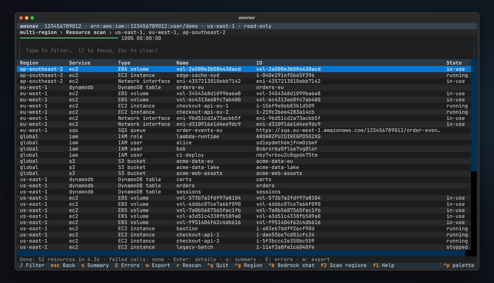
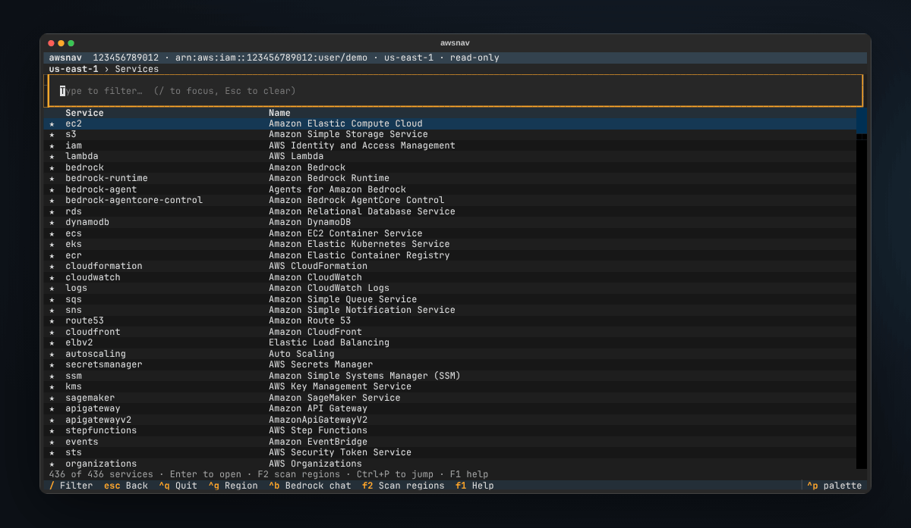
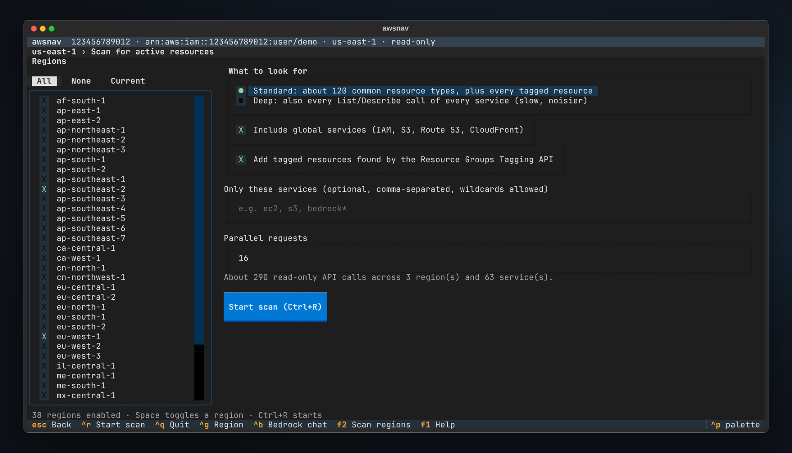
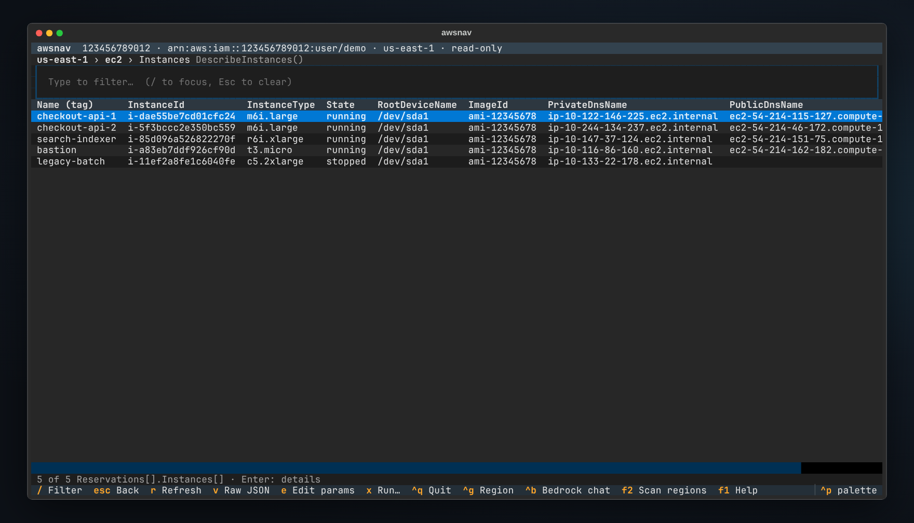
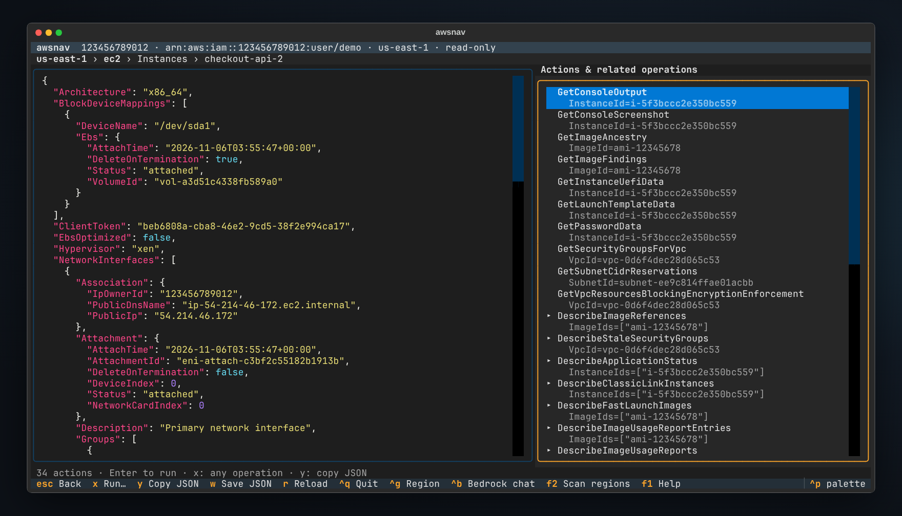
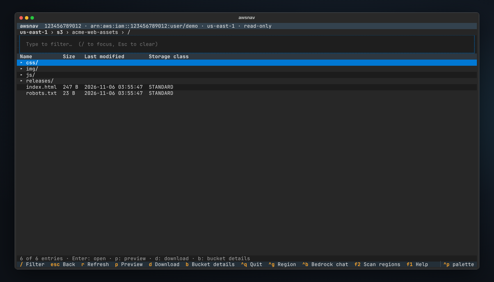
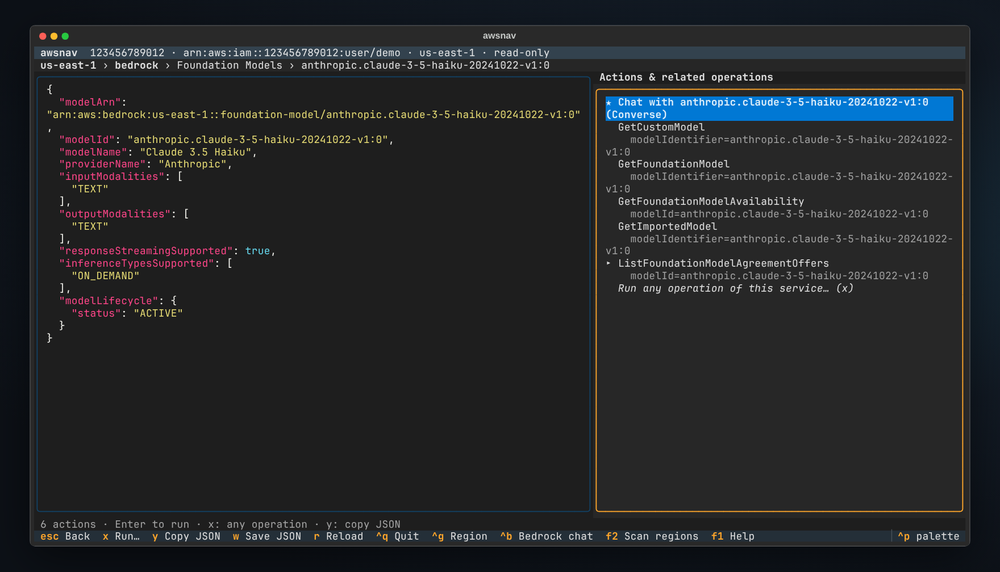
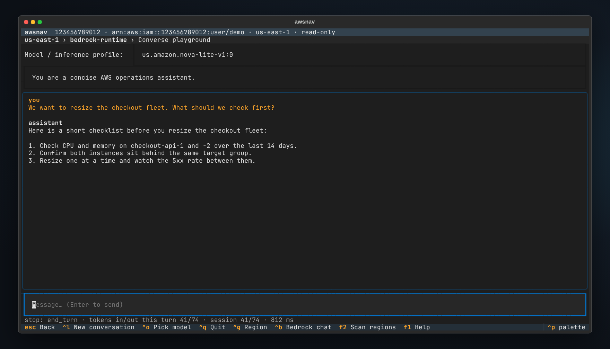
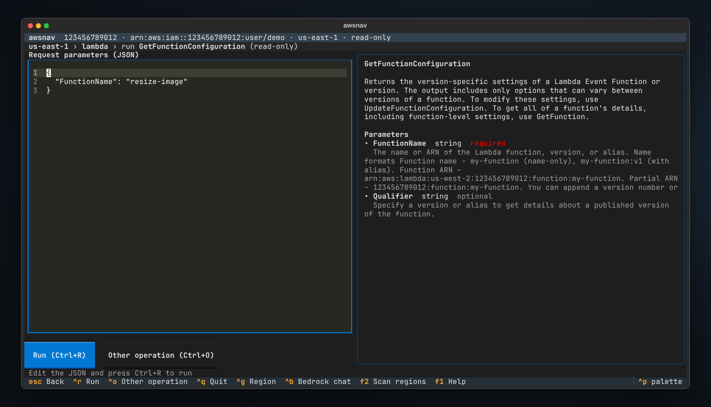

<p align="center">
  
</p>

<h1 align="center">awsnav</h1>

<p align="center">
  <b>Every AWS service in your terminal.</b><br>
  Browse EC2, S3, Bedrock and 430+ other services from the keyboard, scan every region
  for what is actually running, and drill from any resource into the calls that explain it.
</p>

<p align="center">
  <a href="https://pypi.org/project/awsnav/"></a>
  <a href="https://github.com/redasgard/awsnav/actions/workflows/ci.yml"></a>
  
  
  <a href="https://github.com/redasgard/awsnav/blob/main/LICENSE"></a>
</p>

<p align="center">
  <a href="#quick-start">Quick start</a> ·
  <a href="#features">Features</a> ·
  <a href="#scan-every-region">Region scan</a> ·
  <a href="#install">Install</a> ·
  <a href="#keys">Keys</a> ·
  <a href="#how-it-works">How it works</a>
</p>



awsnav reads the API models that ship inside boto3, so it knows every AWS
service the moment boto3 does. EC2 and S3 work the same way as Bedrock,
AgentCore, and whatever AWS launches next week. No plugins, no per-service
code, no command syntax to remember. If boto3 can call it, awsnav can browse it.

## Quick start

```sh
pipx install awsnav        # or: uv tool install awsnav
awsnav
```

Enter an access key and secret, or just press Enter to use your usual AWS
profile, SSO session or environment variables. Type to find a service, `Enter`
to open it, `F2` to scan every region. `F1` shows all keys.

## Features

- **Every service, automatically.** 436 services today, from EC2 and S3 to
  Bedrock, Bedrock Agents and AgentCore. Each one opens on its resource types,
  such as Instances, Buckets, Foundation Models or Agents. Upgrading boto3 adds
  new services and API calls with no awsnav release.
- **Scan every region at once.** `F2` finds active resources across all
  regions, or the ones you pick, and streams them into one table. AWS-created
  defaults are left out, so you see what *you* run. Export to JSON or CSV, or
  run the same scan from scripts with `awsnav --scan`.
- **Drill down without reading docs.** Open any resource and awsnav lists the
  read-only calls that its fields can fill in. A bucket leads to its policy,
  versioning and objects. An instance leads to its console output, status, image
  and subnet. A Bedrock agent leads to its versions and aliases.
- **Bedrock built in.** List foundation models, custom models, guardrails,
  agents and knowledge bases, then chat with any text model or inference
  profile straight from its detail screen (`Ctrl+B` anywhere).
- **S3 like a file manager.** Browse buckets as folders, preview an object's
  first 64 KiB with syntax highlighting, and download it.
- **Any API call when you need it.** The operation runner calls any of the
  thousands of AWS operations with JSON parameters. It is prefilled from the
  resource you are on, with the AWS documentation shown alongside.
- **Safe by default.** Browsing and scanning only ever call read-only
  operations. Write calls need `--allow-write` *and* a confirmation that shows
  exactly what will run. Credentials stay in memory and are never written to
  disk.
- **Region-aware.** `Ctrl+G` switches region. Anything opened from a scan
  result keeps working in that resource's own region, wherever you are.
- **Works anywhere a terminal does.** Over SSH, in tmux, on a jump host,
  against LocalStack (`--endpoint-url`). Light on dependencies: boto3 and
  Textual.

### In motion

Find EC2, open the instances, look at one, then scan three regions and filter
the results. Afterwards, ask a Bedrock model a question without leaving the
terminal.



### Scan every region

Pick regions and press `Ctrl+R`. The estimate tells you how many read-only
calls the scan will make before you start.



The standard scan covers about 120 resource types across compute, networking,
storage, databases, analytics, AI/ML, security and developer tools, plus every
resource the Resource Groups Tagging API knows about. AWS-created defaults are
skipped: default VPCs and their subnets and security groups, AWS-managed keys,
service-linked roles, managed EventBridge rules, terminated instances and
deleted stacks. **Deep mode** adds every parameterless List and Describe call
of every service, except catalogue lookups such as instance types, for when
"about 120 types" is not enough.

Global services such as IAM, Route 53 and CloudFront are scanned once, and S3
buckets land in their own region. Calls that fail are grouped as missing
permission, not offered in that region, or other error (`E`), so a partial
result is never silent.

```sh
awsnav --scan                                          # all enabled regions, table on stdout
awsnav --scan --scan-regions us-east-1,eu-west-1 -o inventory.csv
awsnav --scan --services 'ec2,rds,bedrock*' -o inventory.json
awsnav --scan --deep --workers 32 -o everything.json
```

### Resources and details

Resource lists pick their own columns: names from `Name` tags, IDs, states,
types and dates first; ARNs and URLs last. `/` filters as you type.



A resource's details show its full JSON next to everything you can do with it.
Calls marked `▸` lead to more resources, and they chain: bucket, object, object
tags.



### S3



### Bedrock

Models, profiles, agents, knowledge bases, guardrails and AgentCore runtimes
are all browsable. Any text model is one keypress away from a chat.





### Operation runner

Any operation, any parameters. Required fields are templated, values are
prefilled from where you came from, and the AWS documentation for every
parameter sits on the right.



<sub>Screenshots show a demo account served by [moto](https://github.com/getmoto/moto), a local AWS mock;
Bedrock replies are stubbed. They are regenerated from the real app with `scripts/` (see
[docs/RELEASING.md](https://github.com/redasgard/awsnav/blob/main/docs/RELEASING.md)).</sub>

## Install

awsnav is on [PyPI](https://pypi.org/project/awsnav/). It needs Python 3.10 or
newer and a terminal with 256 colours, and runs wherever
[Textual](https://textual.textualize.io/) does: Linux, macOS and Windows.

| Tool | Install | Upgrade | Remove |
| --- | --- | --- | --- |
| [pipx](https://pipx.pypa.io/) (recommended) | `pipx install awsnav` | `pipx upgrade awsnav` | `pipx uninstall awsnav` |
| [uv](https://docs.astral.sh/uv/) | `uv tool install awsnav` | `uv tool upgrade awsnav` | `uv tool uninstall awsnav` |
| pip, in a virtual environment | `pip install awsnav` | `pip install -U awsnav` | `pip uninstall awsnav` |

pipx and uv give awsnav its own environment and put the `awsnav` command on
your `PATH`. Check the install with `awsnav --version`.

### Try it without installing

```sh
uvx awsnav            # or: pipx run awsnav
```

### Pick up services AWS just launched

awsnav learns every service from boto3, which AWS updates several times a week.
Upgrade boto3 inside awsnav's environment to get new services and API calls
without waiting for an awsnav release:

```sh
pipx runpip awsnav install -U boto3    # pipx
uv tool upgrade awsnav                 # uv: upgrades boto3 as well
pip install -U boto3                   # pip, with the environment active
```

### With pip

```sh
python -m venv .venv
. .venv/bin/activate          # Windows: .venv\Scripts\activate
pip install awsnav
```

### Latest code from `main`

```sh
pipx install git+https://github.com/redasgard/awsnav
```

### Verify a release

CI builds every release and signs it with
[SLSA](https://slsa.dev/) provenance, and the files on PyPI are those same
files. To check one, download the wheel and `awsnav.intoto.jsonl` from the
[release page](https://github.com/redasgard/awsnav/releases), then run
[slsa-verifier](https://github.com/slsa-framework/slsa-verifier) 2.7 or newer:

```sh
slsa-verifier verify-artifact awsnav-0.1.0-py3-none-any.whl \
  --provenance-path awsnav.intoto.jsonl \
  --source-uri github.com/redasgard/awsnav --source-tag v0.1.0
pipx install ./awsnav-0.1.0-py3-none-any.whl
```

## Credentials and permissions

awsnav uses the same credentials as the AWS CLI:

- **Keys** from `--access-key`, `--secret-key` and `--session-token`, or typed
  into the login form. Without them, the `AWS_ACCESS_KEY_ID`,
  `AWS_SECRET_ACCESS_KEY` and `AWS_SESSION_TOKEN` variables fill the form.
- **A profile** with `--profile NAME`, which takes precedence over key variables.
- **The default chain** (`~/.aws`, SSO, instance roles) when the form is left
  empty.

The identity is checked with STS on connect and shown in the top bar. For
browsing and scanning, the AWS managed `ReadOnlyAccess` policy covers almost
everything; anything it does not cover shows up as a clear permission error,
not a crash. See [SECURITY.md](https://github.com/redasgard/awsnav/blob/main/SECURITY.md) for exactly what awsnav does with
your keys.

| Option | Meaning |
| --- | --- |
| `--region` | Starting region (`$AWS_REGION`, then `us-east-1`). Switch any time with `Ctrl+G`. |
| `--profile` | Use a named profile instead of keys. |
| `--endpoint-url` | Send every call to another endpoint, such as LocalStack at `http://localhost:4566`. |
| `--max-items` | Items fetched per list call. Default 500. |
| `--allow-write` | Let the operation runner call write operations, each after confirmation. |
| `--no-login` | Skip the login form and connect with the default credential chain. |
| `--scan` | Headless region scan, tuned with `--scan-regions`, `--deep`, `--services`, `--no-global`, `--no-tagged`, `--workers` and `-o`. |

## Keys

| Key | Action |
| --- | --- |
| type, then `Enter` | filter the list and open the selection |
| `Esc` | clear the filter, then go back one level |
| `/` | filter the current list (every word must match) |
| `Ctrl+P` | jump to any service by name |
| `Ctrl+G` | change region |
| `F2` | scan regions for active resources |
| `Ctrl+B` | Bedrock chat |
| `F1` or `?` | all keys |
| `a` | in a service: show every API operation, not only resource lists |
| `x` | run any operation, prefilled from the current resource |
| `r` / `v` / `e` | in a list: refresh / raw JSON / edit parameters and run again |
| `y` / `w` | in details: copy JSON / save JSON to a file |
| `p` / `d` / `b` | in S3: preview / download / bucket details |
| `s` / `E` / `w` | in scan results: summary / failed calls / export |
| `Ctrl+R` | run the operation, or start the scan |
| `Ctrl+Q` | quit |

## How it works

```
awsnav/
  catalog.py      reads botocore's API models: services, operations, parameters,
                  where the resource list sits in each response, and which
                  operations a resource's fields can fill in
  session.py      credentials, per-region clients, paginated calls
  scanner.py      multi-region scan: curated inventory, tagging pass, deep mode
  formatting.py   column choice and cell rendering for any response shape
  ui/             Textual screens: services, resources, details, runner,
                  S3 browser, Bedrock chat, scan setup and results
```

Nothing is hard-coded per service. A resource type is any `List`, `Describe`
or `Get` call that needs no parameters. A drill-down is any read-only call
whose required parameters can be matched to a resource's fields, for example
`Bucket` from a bucket's `Name`, or `modelIdentifier` from a model's `modelId`.
A handful of curated defaults keep the noisy cases sane, such as listing only
your own AMIs instead of every public one.

## Development

```sh
git clone https://github.com/redasgard/awsnav && cd awsnav
python -m venv .venv && . .venv/bin/activate
pip install -e '.[dev]' ruff
pytest -q
```

The tests never touch AWS. They run against moto and botocore stubs, drive the
real app headlessly through EC2, S3, IAM, SQS, Bedrock and the region scan, and
check that every operation of every bundled service can be described and
templated. See [CONTRIBUTING.md](https://github.com/redasgard/awsnav/blob/main/CONTRIBUTING.md), including how to add a
resource type to the scan.

## License

MIT, see [LICENSE](https://github.com/redasgard/awsnav/blob/main/LICENSE). Made by [Red Asgard](https://github.com/redasgard).

<sub>awsnav is an independent open-source project. It is not affiliated with,
endorsed by or sponsored by Amazon Web Services. AWS and the names of AWS
services are trademarks of Amazon.com, Inc. or its affiliates.</sub>
